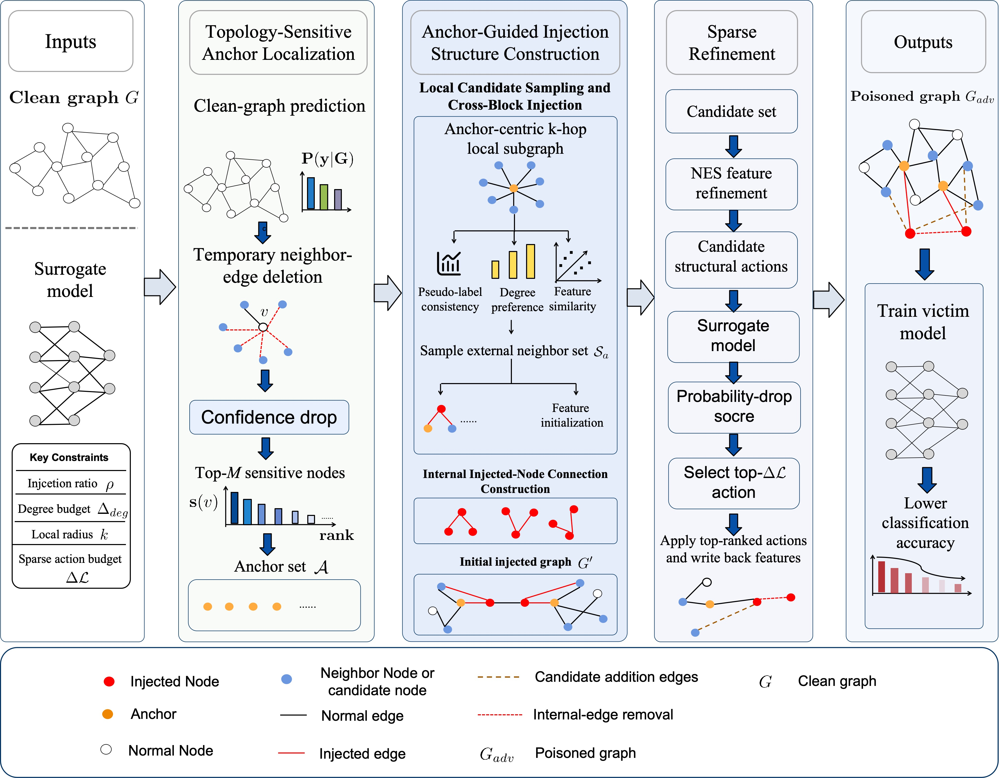

# TS-SNIA

This is the PyTorch implementation of **TS-SNIA: Topology-Sensitivity-Aware Sparse Node Injection Attack Against Graph Neural Networks**, published in **Neurocomputing**.



The paper is available on [ScienceDirect](https://doi.org/10.1016/j.neucom.2026.135414).

The three modules are implemented in `anchor_localization.py`,
`injection_construction.py`, and `sparse_refinement.py`. Parameters and experiment
selections are set in `config.py`. Graph loading and data splits are implemented
in `data.py`, GNNs in `models.py` / `gnn_layers.py`, and the five default defenses
in `defense.py`. Datasets are stored in `data/`.

## Requirements

Tested with Python 3.9, PyTorch 2.1.2, DGL 1.1.2, and CUDA 11.8.

```bash
pip install -r requirements.txt
```

Use CUDA builds of PyTorch, DGL, torch-scatter, and torch-sparse that match each
other. CPU builds can run the same entry points. Cora, Citeseer, Pubmed, and the
Cora-ML archive are available in `data/`.

For Amazon Computers, we recommend downloading the official dataset through
[DGL's AmazonCoBuyComputerDataset](https://www.dgl.ai/dgl_docs/generated/dgl.data.AmazonCoBuyComputerDataset.html),
which is also the loader used in our implementation. The code automatically
downloads missing Amazon data into `data/dgl_amazon/`. To prepare the data before
training, run the following command from the project root:

```bash
python -c "from dgl.data import AmazonCoBuyComputerDataset; AmazonCoBuyComputerDataset(raw_dir='data/dgl_amazon', verbose=True)"
```

## Train

Run TS-SNIA against GCN on each of the five paper datasets:

```bash
# Cora
python main.py --mode train --datasets cora --models gcn

# Citeseer
python main.py --mode train --datasets citeseer --models gcn

# Cora-ML
python main.py --mode train --datasets cora_ml --models gcn

# Pubmed
python main.py --mode train --datasets pubmed --models gcn

# Amazon Computers
python main.py --mode train --datasets amazon_computers --models gcn
```

The commands use seeds 0, 1, and 2 by default; use `--seeds 0` for a single run.

The default injection ratio is 0.05. Models train for at most 200 epochs with
patience 30. Other attack parameters and dataset splits are set in `config.py`
and `data.py`. Cora and Cora-ML use their largest connected component in batch
experiments. All commands use `main.py`.

## Defense

Evaluate each of the seven defenses on Cora using a GCN surrogate:

```bash
# GNNGuard
python main.py --mode defense --datasets cora --models gcn --defenses gnnguard

# RGCN
python main.py --mode defense --datasets cora --models gcn --defenses rgcn

# ProGNN
python main.py --mode defense --datasets cora --models gcn --defenses prognn

# GTrans
python main.py --mode defense --datasets cora --models gcn --defenses gtrans

# GCN-Jaccard
python main.py --mode defense --datasets cora --models gcn --defenses gcn_jaccard

# Collective-LP (optional)
python main.py --mode defense --datasets cora --models gcn --defenses collective_lp

# Node-Aware (optional)
python main.py --mode defense --datasets cora --models gcn --defenses node_aware
```

These commands also use seeds 0, 1, and 2 by default. Collective-LP requires
`Collective_LP/`, and Node-Aware requires `Node_Aware/`. These two directories
are optional; omitting `--defenses` evaluates only GNNGuard, RGCN, ProGNN,
GTrans, and GCN-Jaccard.

The attack uses a fixed clean-trained surrogate. Defended models are trained
independently on clean and poisoned graphs after attack generation; the attack
does not query these evaluation models. The five implementations and their
training interface are contained in `defense.py`.

## Citation

If you find our work useful, please consider citing our paper:

```bibtex
@article{Cui2027TSSNIA,
  title = {{TS-SNIA}: Topology-sensitivity-aware sparse node injection attack against graph neural networks},
  journal = {Neurocomputing},
  volume = {710},
  pages = {135414},
  year = {2027},
  issn = {0925-2312},
  doi = {10.1016/j.neucom.2026.135414},
  author = {Cui, Jianqun and Dai, Wei and Chang, Yanan and Wang, Min and Gao, Mengnan}
}
```
